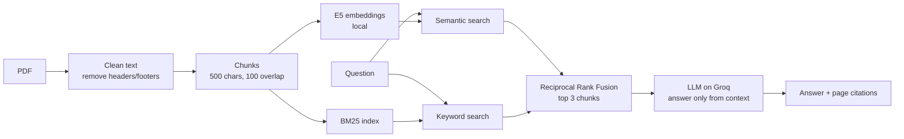

# Computer Architecture Study Bot (RAG)

A retrieval-augmented chatbot that answers questions from computer architecture notes, cites the page it used, and refuses when the answer is not in the notes. Works in English and Roman Urdu.

**Live demo:** https://comparch-study-bot.streamlit.app/

  

## What it does

- Answers only from the source PDF and cites pages, e.g. `[page 4]`
- Says "Ye notes mein nahi hai." when the notes do not contain the answer, instead of making one up
- Hybrid retrieval: semantic search (local multilingual embeddings) + keyword search (BM25), merged with Reciprocal Rank Fusion
- Runs embeddings locally, so documents are never sent to an embedding API and there is no embedding cost
- Evaluated with an automated test set and an LLM-as-a-judge

## Architecture



## Evaluation

Measured with `evaluate.py` on a hand-written test set (`eval_set.json`): questions with an expected page and reference answer, including Roman Urdu questions, short keyword queries, and questions whose answer is **not** in the notes. Answers are graded by a larger LLM (LLM-as-a-judge).

| Version | Questions | Retrieval hit@3 | Answer accuracy | Correct refusals |
|---|---|---|---|---|
| Semantic search, 800-char chunks (baseline) | 20 | 94% | 94% | 100% |
| Hybrid search, 500-char chunks | 20 | 100% | 100% | 100% |
| LangChain + FAISS hybrid pipeline | 24 | 100% | 100% | 100% |

Average end-to-end latency: about 0.6 s per question.

> The settings were tuned on this same small test set, so these numbers are optimistic. A larger, unseen test set is the next step.

## Engineering notes

Problems found through evaluation and how they were fixed:

1. **Diluted chunks.** "What is a load-store architecture?" failed because the relevant sentence sat at the end of a chunk that was mostly about CISC, so its embedding meant "CISC". Hybrid search alone did not fix it. A chunk-size experiment (800 / 500 / 400 / 300) showed 500 characters plus hybrid search retrieved every question correctly.
2. **Each retriever fails differently.** Semantic search missed the exact term "load-store"; BM25 missed the Roman Urdu question "cache line ka size usually kitna hota hai?" because none of its words appear in the notes. Fusing both covers each one's blind spot.
3. **Silent framework gotcha.** E5 embeddings need `query: ` / `passage: ` prefixes. LangChain does not add them by default; without them retrieval dropped from 17/17 to 16/17 with no error.
4. **Short keyword queries.** "what is load-store?" failed in the LangChain version because the right chunk ranked just outside the top 10 semantic results. Retrieving 20 candidates per retriever before fusion fixed it without sending more text to the LLM. The query is now a regression test.

## Tech stack

Python, sentence-transformers (`intfloat/multilingual-e5-small`), rank-bm25, NumPy, Groq (`openai/gpt-oss-20b`), LangChain, FAISS, FastAPI, Streamlit, pypdf

## Run locally

```bash
git clone https://github.com/RohitDhanjee/rag-study-bot.git
cd rag-study-bot
python -m venv venv
venv\Scripts\activate          # macOS/Linux: source venv/bin/activate
pip install -r requirements.txt
```

Create a `.env` file with a free [Groq](https://console.groq.com) API key:

```
GROQ_API_KEY=your_key_here
```

Build the index, then start the chat UI or the API:

```bash
python build_index.py
streamlit run app.py              # chat UI at http://localhost:8501
python -m uvicorn api:app         # API docs at http://127.0.0.1:8000/docs
python evaluate.py                # run the evaluation
```

## Project structure

| File | Purpose |
|---|---|
| `ingest.py` | PDF loading, header/footer cleaning, chunking |
| `embeddings.py` | Local E5 embedding model |
| `build_index.py` | Embeds all chunks and saves the index |
| `search.py` | Semantic, BM25 and hybrid (RRF) search |
| `rag.py` | Prompt + LLM call with citations |
| `lc_rag.py` | Same pipeline rebuilt with LangChain + FAISS |
| `evaluate.py` | Evaluation with LLM-as-a-judge |
| `eval_retrieval.py` | Fast retrieval-only evaluation, no API calls |
| `api.py` | FastAPI endpoint (`POST /ask`) |
| `app.py` | Streamlit chat UI |

## Limitations and next steps

- Small test set (24 questions) that the settings were tuned on
- Chunks never cross page boundaries
- Roman Urdu support depends on a small multilingual model
- Next: larger unseen test set, PDF upload in the UI, streaming answers
